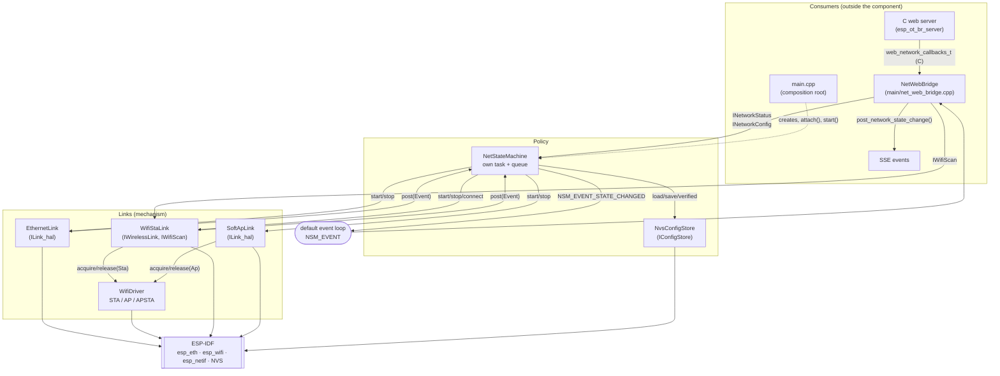
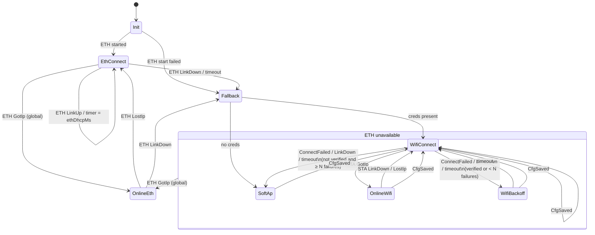

# Network Subsystem (`components/network`)

> Status: branch `refactor_network`, 2026-11-18. The code is authoritative; where this document and the code disagree, the code wins.
> The [Analysis findings](#analysis-findings) section lists known gaps in the current refactoring state.

## Contents

1. [Purpose](#purpose)
2. [Architecture](#architecture)
3. [Components](#components)
4. [Public interfaces](#public-interfaces)
5. [Events](#events)
6. [State machine](#state-machine)
7. [Threading](#threading)
8. [Timers and generations](#timers-and-generations)
9. [Persistence](#persistence)
10. [Logging and troubleshooting](#logging-and-troubleshooting)
11. [Design decisions](#design-decisions)
12. [Analysis findings](#analysis-findings)
13. [Open items](#open-items)

---

## Purpose

The device should always have an uplink:

- **Ethernet has priority.** As soon as ETH has an IP, ETH is used, regardless of the current state.
- **WiFi (STA) is the fallback**, with exponential backoff on failures.
- **Soft AP with web portal** for initial configuration of the WiFi credentials.
- **Reprovisioning via cable:** plug in ETH → web UI reachable via ETH → save new creds → unplug cable → WiFi with the new creds.

## Architecture

The subsystem has two layers.

**Links (mechanism)** each wrap one ESP-IDF driver plus its `esp_netif`. They handle raw ESP-IDF events (`WIFI_EVENT`, `ETH_EVENT`, `IP_EVENT`), update their own `LinkState` and translate the events into a few normalized `Event`s. They make no decisions.

**NetStateMachine (NSM, policy)** decides which uplink is used and manages retries, backoff and timers. It knows the links only through interfaces.

The guiding principle is **dependency inversion**: the interfaces describe what the NSM needs, and the links implement them. Feedback from the links goes through `IEventSink` (the NSM's queue), so there are no cyclic dependencies. Everything is wired together in `main/main.cpp` (composition root).

Outward notifications use the **default ESP-IDF event loop** (`NSM_EVENT`). The component therefore has no dependency on the web server, SSE or the status LEDs; consumers subscribe themselves.



## Components

| File / class | Location | Role |
|---|---|---|
All headers live in `include/` (there is no `private_include/` anymore), because `main.cpp` constructs the concrete classes.

| File / class | Location | Role |
|---|---|---|
| `ILink_hal` | `include/ILink_hal.h` | Common link interface: `start()`, `stop()`, `id()`, `state()`, `netif()`, `ipInfo()`. Also defines `LinkId` and `LinkState`. |
| `IWirelessLink : ILink_hal` | `include/IWirelessLink.h` | Adds `setCredentials()`, `connect()`, `disconnect()`. Only for active links (STA). ETH and AP are passive. |
| `IWifiScan` | `include/IWifiScan.h` | `startScan()` (non-blocking), `scanState()`, `results()`. For the web server. |
| `IEventSink` | `include/IEventSink.h` | `post(const Event&)`: non-blocking, callable from any task. |
| `IConfigStore` | `include/IConfigStore.h` | `loadCreds()`, `saveCreds()` (resets verified), `isVerified()`, `setVerified()`. |
| `INetworkStatus` | `include/INetworkStatus.h` | `isOnline()`, `activeUplink()`, `ipInfo()`. For web server and services. |
| `INetworkConfig` | `include/INetworkConfig.h` | `setWifiCredentials()`. For the web server. |
| `EthernetLink : ILink_hal` | `include/EthernetLink.h` | ESP32 EMAC + LAN87xx PHY, `route_prio = 200` (ETH preferred over WiFi). Creates an IPv6 link-local address on `GotIp` (Thread border router backbone). |
| `WifiStaLink : IWirelessLink, IWifiScan` | `include/WifiStaLink.h` | STA connection and scan. |
| `SoftApLink : ILink_hal` | `include/SoftApLink.h` | Soft AP. SSID = `Board::AP_SSID_PREFIX` + last 2 MAC bytes (e.g. `CZC-A1B2`), channel 1, max. 4 clients, open or WPA2 depending on `Board::AP_PASSWORD`. Posts no events. |
| `WifiDriver` | `include/WifiDriver.h` | Shared `esp_wifi` driver. STA and AP register their role (`acquire`/`release`); the driver derives STA, AP or APSTA from it. No interface. |
| `NetStateMachine` | `include/NetStateMachine.h` | Implements `IEventSink`, `INetworkStatus`, `INetworkConfig`. Own task and queue. Also declares `NSM_EVENT`. |
| `NvsConfigStore : IConfigStore` | `include/NvsConfigStore.h` | NVS-backed config store, namespace `net`, mutex-protected. See [Persistence](#persistence). |
| `WifiCreds` | `include/WifiCreds.h` | SSID (1–32 chars) and password (empty or 8–64), validated in `assign()`. |
| `network_event.h` | `include/network_event.h` | Internal `Event`, `EvType`, `FailReason` and `toString()` helpers. |
| `network_config.h` | `include/network_config.h` | C types of the legacy web server API (`web_network_callbacks_t` etc.). Only used by the temporary bridge. |

Outside the component:

| File | Role |
|---|---|
| `main/main.cpp` | Composition root: creates and wires all network objects. |
| `main/net_web_bridge.{h,cpp}` | Temporary glue (`NetWebBridge`) between the C++ interfaces and the C web server. See [Web server bridge](#web-server-bridge-temporary). |

## Public interfaces

The methods below are meant for code outside the component. The Doxygen comments in the headers are the reference; this section gives an overview plus the calling rules.

### Wiring (`main.cpp`)

Simplified excerpt from `app_main()`:

```cpp
ESP_ERROR_CHECK(nvs_flash_init());
ESP_ERROR_CHECK(esp_event_loop_create_default());
ESP_ERROR_CHECK(esp_netif_init());
ESP_ERROR_CHECK(mdns_init());
ESP_ERROR_CHECK(mdns_hostname_set(Board::HOSTNAME));

static NvsConfigStore  netCfg;
ESP_ERROR_CHECK(netCfg.init());
static WifiDriver      wifiDriver;
static NetStateMachine nsm{netCfg};              // optional: NetParams
static EthernetLink    ethLink{nsm};             // nsm is the IEventSink
static WifiStaLink     staLink{wifiDriver, nsm};
static SoftApLink      apLink{wifiDriver};
nsm.attach(ethLink, staLink, apLink);

static NetWebBridge::Context netBridge{nsm, staLink, netCfg, apLink};
ESP_ERROR_CHECK(NetWebBridge::forwardStateToSse(&netBridge));  // before start()
ESP_ERROR_CHECK(nsm.start());                    // queue, timers, task

// later: NetWebBridge::fillCallbacks(&netCbs, &netBridge); esp_br_web_start(...)
// then:  while (!nsm.isOnline()) vTaskDelay(pdMS_TO_TICKS(500));
```

Requirements: `nvs_flash_init()`, `esp_event_loop_create_default()` and `esp_netif_init()` before `nsm.start()`. All objects are `static`, so they outlive the NSM and the event handlers. mDNS is initialized in `main.cpp`, not in the component.

| Method | Caller / task | Behavior |
|---|---|---|
| `NetStateMachine(IConfigStore&, NetParams = {})` | main | Stores references and parameters only. |
| `attach(eth, sta, ap)` | main, before `start()` | Sets the link pointers. |
| `start()` | main, once | Creates the queue (16 entries), 3 `esp_timer`s and the `nsm` task. Reading NVS and starting ETH happen afterwards in the NSM task. Returns `ESP_ERR_INVALID_STATE` without `attach()` or when called twice. |
| `state()` | any | Current `NetState` (diagnostics). |
| `droppedEvents()` | any | Number of events dropped because the queue was full. Should always be 0. |
| `NetStateMachine::name(NetState)` | any | Printable state name. |

### `INetworkStatus` (web server, services)

| Method | Behavior |
|---|---|
| `isOnline()` | `true` if ETH or STA has an IP (state `OnlineEth` or `OnlineWifi`). Atomic, any task. |
| `activeUplink()` | `LinkId::Eth` or `LinkId::Sta`. Only meaningful while `isOnline()` is true; when offline it returns `Eth`. |
| `ipInfo(out)` | IP, netmask and gateway of the active uplink. `false` when offline. |

### `INetworkConfig` (web server)

| Method | Behavior |
|---|---|
| `setWifiCredentials(creds)` | Runs in the httpd task. Stores the creds (verified is reset) and posts `CfgSaved`. Does not touch NSM state. Returns `ESP_ERR_INVALID_ARG` for an empty SSID, a store error, or `ESP_ERR_NO_MEM` if the queue is full (the creds are stored anyway and take effect at the latest after the next reboot). |

Callers should fill the creds via `WifiCreds::assign(ssid, pass)`, which checks the lengths (SSID 1–32, password empty or 8–64).

### `IWifiScan` (web server)

| Method | Behavior |
|---|---|
| `startScan()` | Starts an asynchronous scan. Returns `ESP_OK` also if one is already running. Returns `ESP_ERR_INVALID_STATE` if the STA link is stopped (state `OnlineEth`, see findings). ESP-IDF rejects a scan while a connection attempt is in progress; the web server should retry. |
| `scanState()` | `Idle`, `Running`, `Done` or `Failed`. Meant for polling. |
| `results(out, max)` | Copies up to `max` entries. Deduplicated (strongest AP per SSID), hidden SSIDs skipped, sorted by RSSI descending, max. 20. |

Scanning bypasses the NSM and goes directly through `WifiStaLink`. Mutex-protected, any task.

### State notifications (`NSM_EVENT`)

After every transition (entry actions done), the NSM posts on the **default event loop**:

| Base / id | Payload | Notes |
|---|---|---|
| `NSM_EVENT` / `NSM_EVENT_STATE_CHANGED` | `NsmStateEvent { NetState state; bool online; LinkId uplink; }` | `uplink` is only meaningful if `online`. Posted with timeout 0; if the loop queue is full the event is dropped and logged (`state event for X not posted`). |

Subscribe like any ESP-IDF event, e.g.:

```cpp
esp_event_handler_register(NSM_EVENT, NSM_EVENT_STATE_CHANGED, &onNetState, ctx);
```

Handlers run in the `sys_evt` task and must not block. The NSM itself does not know who listens. This replaces the old direct call to `Sse_events::network::post_network_state_change()`.

### `IConfigStore` / `NvsConfigStore`

| Method | Caller / task | Behavior |
|---|---|---|
| `NvsConfigStore::init()` | main, after `nvs_flash_init()` | Opens namespace `net` read/write. `ESP_OK` if already open. Must succeed before `nsm.start()`, otherwise every read returns "nothing stored". |
| `loadCreds(out)` | NSM, bridge | `false` if never stored or invalid (fails `WifiCreds::assign()`). A missing `pass` key means open network. |
| `saveCreds(creds)` | NSM (`setWifiCredentials`, httpd task) | Writes `verified = 0`, `ssid`, `pass`, then commits. `ESP_ERR_INVALID_ARG` for empty SSID, `ESP_ERR_INVALID_STATE` if not open. |
| `isVerified()` | NSM | `true` if `verified` is stored and non-zero. |
| `setVerified(v)` | NSM (entering `OnlineWifi`) | Writes and commits the flag. |
| `NvsConfigStore::clear()` | not wired yet | Erases the whole `net` namespace (factory reset). |

All methods lock one mutex, so they are safe from any task. Consumers outside the network component should not write creds through the store directly; use `INetworkConfig::setWifiCredentials()`, otherwise the NSM does not learn about the change.

### Web server bridge (temporary)

The web server (`esp_ot_br_server`) is still C and talks to the network through the `web_network_callbacks_t` table from `network_config.h`. `main/net_web_bridge.cpp` fills this table from the C++ interfaces. It goes away once the web server is ported to C++.

| C callback | Implementation |
|---|---|
| `get_network_status` | `mode` = legacy frontend number (see below), `ip` = uplink IP when online, AP IP (`192.168.4.1`) in `SoftAp`, otherwise empty. |
| `get_wifi_config` | SSID from `IConfigStore::loadCreds()`, `dhcp = true`, rest empty. Password is never returned. |
| `set_wifi_config` | `WifiCreds::assign()` then `INetworkConfig::setWifiCredentials()`. Static IP fields are ignored (logged). |
| `get_ethernet_config` | Always `dhcp = true`. |
| `set_ethernet_config` | `ESP_ERR_NOT_SUPPORTED` (DHCP only). |
| `set_mdns_hostname` | `mdns_hostname_set()`. |
| `get_wifi_scan_results` | **Blocking** in the httpd task: `startScan()` (up to 5 retries, 500 ms apart, if the driver is busy), then polls `scanState()` for up to 10 s. Result array is `calloc`'d and freed by the web server. `authmode` is 1/0 (secured/open), `primary_channel` is always 0. |

`NetWebBridge::forwardStateToSse()` registers a handler on `NSM_EVENT_STATE_CHANGED` and forwards each change as `network_state_change` SSE event.

Mapping to the legacy frontend states (`NET_STATE` in `restful.js`):

| `NetState` | `mode` | Frontend label |
|---|---|---|
| `Init` | 0 | Initializing |
| `OnlineEth` | 1 | Ethernet |
| `OnlineWifi` | 2 | WiFi |
| `SoftAp` | 3 | SoftAP (serves `wifi_config.html` on `/`) |
| `EthConnect` | 4 | ETH Retry |
| `WifiConnect`, `WifiBackoff` | 5 | WiFi Retry |

### Links (NSM only)

`ILink_hal` and `IWirelessLink` are called only by the NSM, always from the NSM task.

| Method | Behavior |
|---|---|
| `start()` | Create driver and netif, register event handlers. STA does not connect here. `ESP_ERR_INVALID_STATE` if already started. |
| `stop()` | Free everything. No event. No-op if stopped. |
| `state()` | `Stopped`, `Down`, `Connecting` (link up, no IP), `Up` (has IP). Atomic. |
| `ipInfo(out)` | `false` without an IP. |
| `setCredentials(creds)` | STA only. Used by the next `connect()`; does not reconnect. |
| `connect()` | STA only. Asynchronous; the result arrives as `GotIp` or `ConnectFailed`. Aborts a running attempt first. |
| `disconnect()` | STA only. Intentional, posts no event. |

## Events

`Event` is trivially copyable so it fits by value into a FreeRTOS queue. Fields: `type`, `link`, `reason`, `timer`, `gen`.

| `EvType` | Source | Meaning |
|---|---|---|
| `LinkUp` | ETH / STA | Cable plugged / WiFi associated (no IP yet). |
| `LinkDown` | ETH / STA | An established connection is gone. From STA with a `FailReason`. |
| `GotIp` | ETH / STA | DHCP lease obtained. |
| `LostIp` | ETH / STA | DHCP lease lost. |
| `ConnectFailed` | STA, NSM (`enter(WifiConnect)`) | Connection attempt failed, with `FailReason` (`AuthFail`, `NoAp`, `Other`). |
| `CfgSaved` | NSM (`setWifiCredentials`) | New creds are in the store. |
| `Timeout` | NSM timer | With `timer` id and generation `gen`. |

Mapping of WiFi disconnect reasons in `WifiStaLink::mapReason()`:

| ESP-IDF reason | `FailReason` |
|---|---|
| `AUTH_FAIL`, `4WAY_HANDSHAKE_TIMEOUT`, `HANDSHAKE_TIMEOUT`, `MIC_FAILURE` | `AuthFail` |
| `NO_AP_FOUND` | `NoAp` |
| all others | `Other` |

Whether a disconnect is reported as `LinkDown` or `ConnectFailed` depends on the previous `LinkState`: `Up` → `LinkDown`, `Connecting` → `ConnectFailed`, otherwise it is ignored.

**Intentional disconnects** (`disconnect()`, `stop()`) produce no events. `stop()` unregisters the handlers before shutting down. `disconnect()` sets the `intentional_` flag; the following `WIFI_EVENT_STA_DISCONNECTED` with reason `WIFI_REASON_ASSOC_LEAVE` is then swallowed.

## State machine

### States

| State | Meaning |
|---|---|
| `Init` | Only until `init()` runs in the task. |
| `EthConnect` | ETH started, waiting for link or DHCP. |
| `OnlineEth` | Online via ETH. STA and AP are off. |
| `WifiConnect` | Connection attempt with stored creds. |
| `WifiBackoff` | Waiting before the next attempt. |
| `OnlineWifi` | Online via STA. |
| `SoftAp` | Portal active (APSTA), STA does not connect. |

The last four form the superstate "ETH unavailable" (`inFallback()`).

Two persistent values drive the logic:

- **creds**: SSID/password present (`creds_.valid()`).
- **verified**: these creds have connected successfully at least once. Set on entering `OnlineWifi`, reset whenever new creds are saved.

### Diagram



### Global events (any state, `handleGlobal()`)

- **ETH `GotIp`** → `OnlineEth` (no self-transition if already there).
- **`CfgSaved`** → reload creds and verified, reset `failCount_` and backoff, pass the creds to STA. In the "ETH unavailable" superstate → `WifiConnect`. In `EthConnect`/`OnlineEth` the creds are only kept; they are used once the cable is unplugged.

### Transitions

| From | Event | To |
|---|---|---|
| `Init` | always (after reading NVS and starting ETH) | `EthConnect`; if the ETH start fails → fallback selection |
| `EthConnect` | ETH `LinkUp` | stays, timer restarted with `ethDhcpMs` |
| `EthConnect` | ETH `LinkDown` / timeout | fallback selection |
| `OnlineEth` | ETH `LinkDown` | fallback selection |
| `OnlineEth` | ETH `LostIp` | `EthConnect` |
| fallback selection | creds present / absent | `WifiConnect` / `SoftAp` |
| `WifiConnect` | STA `GotIp` | `OnlineWifi` |
| `WifiConnect` | STA `LinkUp` | stays (associated, DHCP running) |
| `WifiConnect` | STA `ConnectFailed` / `LinkDown` / timeout | `SoftAp` if not verified and `failCount_ ≥ unverifiedAttempts`; otherwise `WifiBackoff`. On timeout, `sta.disconnect()` is called first. |
| `WifiBackoff` | timeout | `WifiConnect` |
| `OnlineWifi` | STA `LinkDown` / `LostIp` | `WifiConnect` (immediately, no backoff) |
| `SoftAp` | `CfgSaved` | `WifiConnect` |

ETH events other than `GotIp` are ignored in the superstate; STA events are ignored in the ETH states.

### Entry actions

| State | Action |
|---|---|
| `EthConnect` | offline; timer `ethLinkWaitMs` (3 s), or `ethDhcpMs` (10 s) if the link is already up (`LinkState::Connecting`, e.g. after `LostIp`). |
| `OnlineEth` | online = ETH; stop STA and AP (frees the radio). |
| `WifiConnect` | offline; start STA if needed, then `connect()`, timer `wifiConnectMs` (15 s). If the start or `connect()` fails immediately, `ConnectFailed` is posted to the NSM's own queue (no transition inside `enter()`). |
| `WifiBackoff` | timer = `backoffMs_` + jitter (0–25 %), then double `backoffMs_` (2 s … 60 s). |
| `OnlineWifi` | online = STA; set and persist verified (if not yet); reset counter and backoff; stop AP. |
| `SoftAp` | offline; reset `failCount_`; start AP first, then STA (→ APSTA, required for scanning); STA does not connect. |

**Exit actions:** only stop the state's timer. The AP intentionally stays on when leaving `SoftAp` until a connection is up, so the portal remains reachable during the first attempt with new creds.

### Parameters (`NetParams`)

| Field | Default | Effect |
|---|---|---|
| `ethLinkWaitMs` | 3000 | Wait for cable link in `EthConnect` |
| `ethDhcpMs` | 10000 | Wait for DHCP once the link is up |
| `wifiConnectMs` | 15000 | Max. duration of one STA attempt |
| `backoffMinMs` | 2000 | First backoff |
| `backoffMaxMs` | 60000 | Backoff upper limit |
| `unverifiedAttempts` | 3 | Failures with unverified creds before `SoftAp` |
| `taskStack` | 4096 | NSM task stack (bytes) |
| `taskPrio` | 5 | NSM task priority |

### Typical flows

**First setup without cable:** `Init` → `EthConnect` → (3 s timeout) → `SoftAp`. The user joins `CZC-xxxx` and enters creds → `CfgSaved` → `WifiConnect` (AP stays on) → `OnlineWifi` → verified = 1, AP off.

**Typo in the password:** `WifiConnect` → `ConnectFailed(AuthFail)` → `WifiBackoff` → … after 3 failures → `SoftAp`.

**Router boots slower than the device after a power outage:** creds are verified → only `WifiConnect` ↔ `WifiBackoff` with growing backoff, never `SoftAp`.

**Reprovisioning via cable:** plug in cable → `OnlineEth` → web UI → `setWifiCredentials()` → in `OnlineEth` the creds are only stored → unplug cable → `WifiConnect` with the new creds.

## Threading

| Context | What runs there |
|---|---|
| `sys_evt` (ESP-IDF event loop) | Link event handlers: update `LinkState`, log and `post()`, nothing else. Also all `NSM_EVENT` subscribers (e.g. the SSE forwarder of the bridge). |
| `esp_timer` | `timerCallback()`: only posts a `Timeout`. |
| `nsm` (own task) | All state logic, processed sequentially from the queue. NSM state and links are only modified here, so there are no mutexes in the logic. Posts `NSM_EVENT_STATE_CHANGED`. |
| `httpd` | Via the bridge: `setWifiCredentials()` (stores and posts), `INetworkStatus` getters, `IWifiScan`. The scan callback blocks the httpd task for up to ~12 s. |
| `main` | Polls `isOnline()` every 500 ms until the first uplink is up, then starts time service and application. |

- Queue with 16 entries; `post()` never blocks. An overflow is counted (`droppedEvents()`) and logged with `ESP_LOGE`. It is treated as a design error, not a normal case.
- `INetworkStatus` can be read from any task (`std::atomic`).
- Link states are `std::atomic`, scan results are protected by `scanMtx_`, `WifiDriver` and `NvsConfigStore` have their own mutexes.

## Timers and generations

There are three `esp_timer` one-shots (`Eth`, `Wifi`, `Backoff`). They only post a `Timeout` event.

Problem: a timeout may already be in the queue when the timer is stopped or restarted. Solution: every timer has a generation counter that is incremented on **every start and stop**. The event carries the generation at fire time, and `dispatch()` drops timeouts with a stale generation (visible in the debug log as `stale timeout`).

## Persistence

`NvsConfigStore`, namespace `net`:

| Key | Type | Content |
|---|---|---|
| `ssid` | str | SSID |
| `pass` | str | Password; missing/empty = open network |
| `verified` | u8 | 1 = the creds have worked before |

When saving, `verified = 0` is written **first**. If power fails mid-write, the creds count as unverified and the way back to the Soft AP stays open. The WiFi driver does not store creds itself (`WIFI_STORAGE_RAM`); the store is the single source of truth.

`init()` opens the namespace and requires `nvs_flash_init()`. `clear()` erases the namespace (factory reset) but has no trigger yet.

The old network component stored creds in namespace `wifi_cfg` (keys `ssid`, `password`). These are **not** read by `NvsConfigStore`; after a firmware update devices start without creds and open the Soft AP (see [Open items](#open-items)).

## Logging and troubleshooting

| Tag | Source |
|---|---|
| `nsm` | NetStateMachine |
| `EthernetLink` | EthernetLink |
| `WifiStaLink` | WifiStaLink |
| `soft_ap` | SoftApLink |
| `WifiDriver` | WifiDriver |
| `net_cfg` | NvsConfigStore |
| `net_bridge` | NetWebBridge (`main/`) |

Log levels:

- **E**: errors that abort a function (driver install, netif, queue full, NVS write errors).
- **W**: expected disturbances (connection lost, auth failure with reason code, timeout, IP lost, scan rejected).
- **I**: state transitions (`nsm: WIFI_CONNECT -> ONLINE_WIFI`), link up/down, obtained IP, portal clients.
- **D**: every event processed by the NSM (`[STATE] event X link=Y reason=Z`), dropped stale timeouts, driver mode changes, intentional disconnects, scan details.

Enable debug output selectively (requires `CONFIG_LOG_MAXIMUM_LEVEL` ≥ Debug):

```cpp
esp_log_level_set("nsm", ESP_LOG_DEBUG);
esp_log_level_set("WifiStaLink", ESP_LOG_DEBUG);
```

Diagnosis hints:

- Device stays in `SOFT_AP` although creds are stored: search the log for `connect failed, reason N (AuthFail|NoAp|Other)`. `N` is the `wifi_err_reason_t` code.
- Device oscillates between `WIFI_CONNECT` and `WIFI_BACKOFF`: the backoff time is logged as `retry WiFi in X ms`.
- `queue full … dropped` should never appear. If it does, the NSM task is blocked (stack, priority, slow NVS access).
- Portal not reachable although the client got a `192.168.4.x` lease (`DHCP server assigned IP to a client`) and no `httpd_accept_conn` lines appear: the client does not send the request over WiFi. Typical for Android with mobile data on (see findings). Test with mobile data off or with `curl -v http://192.168.4.1/` from a laptop.

## Design decisions

- **Raw events in the link, normalized events in the NSM.** The NSM stays independent of the ESP-IDF network APIs and can be tested on the host.
- **`connect()`/`disconnect()` only in `IWirelessLink`** (interface segregation). ETH is passive and does not need them.
- **Default route via `route_prio`** (ETH 200, STA 100) instead of manual switching. ESP-IDF switches the default route itself.
- **Scan as a separate interface for the web server**, not through the NSM. ESP-IDF rejects a scan during a connection attempt ("busy"); the web server retries. Results are deduplicated (strongest AP per SSID), sorted by RSSI, max. 20.
- **With verified creds there is no automatic way back to the Soft AP.** A router that boots slower after a power outage must not push the device into AP mode. Reprovisioning is done via cable.
- **No transitions inside `enter()`.** Immediate failures are queued as events so that `transition()` is never called recursively.
- **AP stays on after `SoftAp`** until a connection is up. In APSTA the AP follows the STA's channel; portal clients briefly lose the connection while the STA connects.
- **One shared `WifiDriver`.** STA and AP share one radio; reference counting via role bits prevents one link from tearing down the driver under the other.
- **Notifications via the default event loop, not via callbacks or direct calls.** The network component must not depend on the web server or SSE. Consumers subscribe to `NSM_EVENT`; wiring lives in the composition root.
- **All headers public.** The composition root (`main.cpp`) constructs the concrete links, store and driver, so their headers must be includable. Consumers that only need status or config should still depend on the interfaces only.

## Analysis findings

Result of the code analysis on 2026-11-18, updated after integration. The items below are documented, not fixed.

The build blockers found in the first analysis are resolved: interface names unified (`ILink_hal`, `IWirelessLink`), public inheritance, all pure virtuals implemented, `SoftApLink` derives from `ILink_hal`, `NvsConfigStore.h` added, headers moved to `include/`, CMake dependencies (`esp_wifi`, `esp_timer`, `nvs_flash`) and `idf_component.yml` (`espressif/lan87xx`) added. The firmware builds with ESP-IDF 6.0.2.

### Integration

1. **Android does not reach the portal.** With an open AP without internet, Android keeps routing browser traffic over mobile data. The client gets a DHCP lease, but no HTTP request reaches the ESP and Chrome shows `ERR_TOO_MANY_RETRIES`. Works with mobile data off. Real fix: captive portal DNS plus redirects for the OS connectivity checks (see open items).
2. **Thread backbone netif can disappear.** `thread_controller.cpp` looks up `ETH_DEF`, else `WIFI_STA_DEF`, once at start. In `OnlineEth` the STA link is stopped and its netif destroyed; if the border router was started on STA and ETH takes over later, it keeps a dangling netif. The NSM should notify the protocol stack (via `NSM_EVENT`) or the STA netif should be kept alive.
3. **Blocking scan in the httpd task.** The bridge blocks the single httpd task for the duration of the scan (up to ~12 s). Other requests, including the portal page, stall meanwhile. Fine for the portal, but the C++ web server should use the asynchronous `IWifiScan` API.
4. **No Ethernet static IP and no WiFi static IP anymore.** The old API supported them; the bridge ignores them (`ESP_ERR_NOT_SUPPORTED` / logged warning). The frontend still shows the fields.
5. **AP is switched off immediately on `OnlineWifi`.** The portal's redirect (`pollWifiConnection()` in `restful.js`) only works if a poll hits the short window before the AP goes down. Consider stopping the AP a few seconds later.

### Logic and runtime

1. **Race on the verified flag.** `setWifiCredentials()` (httpd) and `enter(OnlineWifi)` (NSM) both write `verified`. Sequence: the NSM connects with the old creds while the user saves new ones → `saveCreds()` writes 0 → `enter(OnlineWifi)` writes 1 for the *old* creds → `onCfgSaved()` reads `verified = true` for the *new* ones. Wrong new creds then never lead back to the Soft AP. Fix: only call `setVerified()` if the stored creds match the connected ones (comparison or a generation counter in the store), or move saving into the NSM task.
2. **No scan over ETH.** In `OnlineEth` the STA is stopped, so `startScan()` returns `ESP_ERR_INVALID_STATE`. During reprovisioning via cable the user has to type the SSID manually. If that is intended, the web portal should say so; otherwise the STA would have to be started briefly for the scan.
3. **`SoftAp` is a dead end with unverified creds.** Without `CfgSaved` or ETH there is no further attempt. Example: creds just saved but the router is still off → after 3 failures the device stays in the portal for good. Worth considering: a periodic STA attempt from `SoftAp` (e.g. every 5 min) while no client is connected to the AP.
4. **Brief default AP on start.** `SoftApLink::start()` first calls `drv_.acquire(Ap)` (starts the driver in AP mode with the default config) and only then `configure()`. For a moment an AP named `ESP_xxxxxx` is visible before the AP restarts with the correct SSID.
5. **`intentional_` can get stuck.** If `esp_wifi_disconnect()` does not produce a `STA_DISCONNECTED` with `ASSOC_LEAVE` (e.g. when not yet associated), the flag stays set and swallows a later genuine `ASSOC_LEAVE`. Fix: reset the flag in `connect()`.
6. **STA events carry no attempt id.** A late `ConnectFailed` from an aborted attempt could in theory be attributed to the next attempt. Rare thanks to the `intentional_` flag, but not impossible.
7. **`isOnline()` and `activeUplink()` are two separate atomics.** A reader may briefly see an inconsistent pair while switching between ETH and STA. Fix: pack both into one atomic.
8. **3 s `ethLinkWaitMs` at boot is tight.** LAN87xx reset plus autonegotiation often take 2–3 s. With a cable plugged in, the device then briefly starts WiFi until ETH `GotIp` takes over. Functionally correct, but unnecessary radio activity.
9. **SMI pins not set explicitly.** `Board::MDC_PIN`/`MDI_PIN` are not used in `EthernetLink::start()`; it only works because they match the EMAC defaults (23/18).
10. **Destruction order.** If the NSM is destroyed before the links, their handlers post into a deleted queue. In the firmware all objects are static; for host tests this matters.
11. **`release()` ignores errors from `applyMode()`**, e.g. when switching APSTA → STA. This is now logged but not handled.

## Open items

- **Captive portal DNS** (high priority, see Android finding): DNS server answering every query with `192.168.4.1`, plus redirects for the OS connectivity checks (`/generate_204`, `/hotspot-detect.html`, …). Does not belong in `SoftApLink`, but in the web server or a separate class.
- **Migrating creds from the old NSM** for devices in the field: read the old creds from namespace `wifi_cfg` (keys `ssid`, `password`), store them in the new store, set verified = 1.
- **Port the web server to C++**; it gets `INetworkStatus`, `INetworkConfig` and `IWifiScan` directly, and `main/net_web_bridge.*` plus `network_config.h` go away.
- **Remove `network_config.h` fields** that are no longer supported (static IP) together with the frontend fields.
- **Host tests for the NSM:** put `esp_timer`/FreeRTOS behind an `ITimerService` and call `dispatch()` directly.
- **Factory reset:** `NvsConfigStore::clear()` has no trigger yet (e.g. long button press).

Done: wiring in the composition root (`main.cpp`), state notifications via `NSM_EVENT`, temporary web server bridge.
