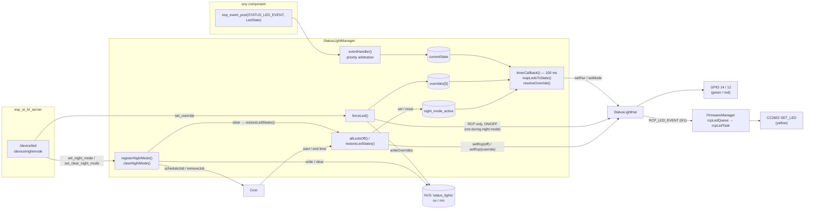
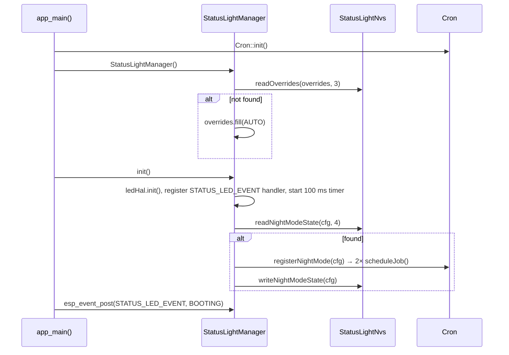
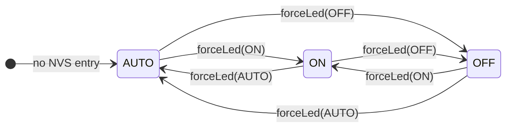
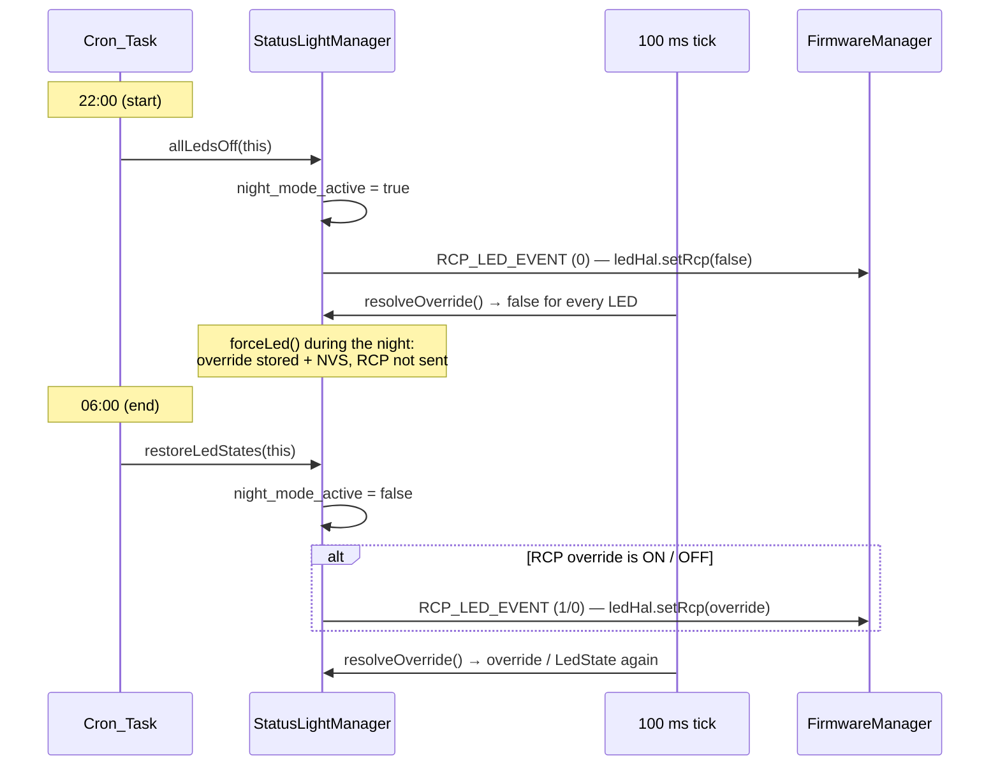

# status_light

Event-driven status LED manager for the CZC firmware.

Controls three LEDs:

| LED | `LedId` | Colour | Driven by |
|-----|---------|--------|-----------|
| Power | `PWR` (0) | Green | ESP32 GPIO — `Board::LED_PWR_PIN` (GPIO 14) |
| Mode | `MODE` (1) | Red | ESP32 GPIO — `Board::LED_MODE_PIN` (GPIO 12) |
| Zigbee | `RCP` (2) | Yellow | CC2652P7 (RCP) — not an ESP32 GPIO; set via a vendor Z-Stack MT command over the RCP UART, see [Zigbee LED](#zigbee-led-cc2652p7-yellow) |

The two GPIO LEDs are driven directly by this component. The Zigbee LED is only
*requested* here (via `RCP_LED_EVENT`) — the actual MT command is sent by
`firmware_manager` / `zstack_mt`.

On top of the automatic state display the component offers:

- **[LED overrides](#led-overrides)** — force any LED `ON` / `OFF`, or hand it back to `AUTO`.
- **[Night mode](#night-mode)** — a daily time range in which all LEDs are masked off (overrides stay untouched), driven by two [`cron`](../cron) jobs.
- **[Persistence](#persistence-nvs)** — overrides and the night-mode range survive a reboot.

All three are reachable from the web UI (*Debug → LEDs / Night-Mode*) through
`web_led_callbacks_t`.

---

## Architecture

The automatic LED display is a pure **event subscriber** — other components never call
the manager directly, they post `LedState` events into the default ESP event loop.
Overrides and night mode are the only direct entry points, and they are only used by the
web server (via C callbacks) and by the manager's own cron jobs.



The Zigbee LED path is described in detail in [Zigbee LED](#zigbee-led-cc2652p7-yellow).

### Internal structure

| File | Role |
|------|------|
| `include/status_light_event.h` | Public — `LedState` enum + `STATUS_LED_EVENT` base (post into it) and `RCP_LED_EVENT` base (subscribe to it to drive the Zigbee LED). |
| `include/status_light_manager.h` | Public — `StatusLightManager` class, `LedId` / `LedOverride` enums. Include this in `main` to call `init()` / `fillLedCallbacks()`. |
| `include/status_light_callbacks.h` | Public, C-compatible — `night_mode_config_t` and `web_led_callbacks_t`, included by `esp_br_web.h`. |
| `include/status_light_hal.h` | `StatusLightHal` — raw LED control (`setPwr()`, `setMode()`, `setRcp()`). Only used by the manager. |
| `private_include/status_light_nvs.h` | Private — `StatusLightNvs` namespace, NVS bindings for overrides and night mode. |
| `src/status_light_hal.cpp` | GPIO init, `setPwr()`, `setMode()`; `setRcp()` posts `RCP_LED_EVENT`. |
| `src/status_light_manager.cpp` | Event handler, 100 ms timer, blink logic, overrides, night-mode cron jobs, web callbacks. |
| `src/status_light_nvs.cpp` | Blob read / write / erase in the `status_lights` NVS namespace. |

Dependencies (`CMakeLists.txt`): `board_config`, `esp_driver_gpio`, `cron`, `nvs_flash`
(private); `esp_event`, `esp_timer`, `log` (public).

---

## Initialisation

Call `init()` once in `main` after `nvs_flash_init()`, `esp_event_loop_create_default()`
**and `Cron::init()`** — `init()` re-registers a stored night mode as cron jobs:

```cpp
#include "status_light_manager.h"
#include "cron.h"

ESP_ERROR_CHECK(nvs_flash_init());
ESP_ERROR_CHECK(esp_event_loop_create_default());

Cron::init();                        // before StatusLightManager::init()

StatusLightManager statusLight;      // ctor restores overrides from NVS
ESP_ERROR_CHECK(statusLight.init()); // HAL, event handler, timer, night mode from NVS

// ... later, before esp_br_web_start():
web_led_callbacks_t ledCbs{};
statusLight.fillLedCallbacks(&ledCbs);
esp_br_web_start("/spiffs", &fwCbs, &netCbs, &ledCbs);
```

What happens on boot:



The cron jobs only fire once `TimeService` has synced the clock — until then the night
mode is registered but inactive.

---

## Posting state changes

Include `status_light_event.h` in any component that needs to report a state. No other header is needed.

```cpp
#include "status_light_event.h"

// Signal that flashing has started
esp_event_post(STATUS_LED_EVENT,
               static_cast<int32_t>(LedState::FLASHING),
               nullptr, 0, 0);

// Signal that the Thread stack is up
esp_event_post(STATUS_LED_EVENT,
               static_cast<int32_t>(LedState::THREAD_ACTIVE),
               nullptr, 0, 0);
```

> **Note:** `esp_event_post` is fire-and-forget and safe to call from any task (use `esp_event_isr_post` from an ISR context).

---

## LED states

States are prioritised: `eventHandler()` only accepts an incoming state whose numeric value
is **greater than or equal to** the current one. A higher-priority state therefore blocks
lower-priority events.

| State | Value / priority | Power LED (green) | Mode LED (red) | When to post |
|-------|------------------|-------------------|----------------|--------------|
| `ERROR` | 8 (highest) | blink 3 Hz | blink 3 Hz | Unrecoverable fault |
| `FLASHING` | 7 | blink 1 Hz | blink 1 Hz | RCP or ESP firmware update in progress |
| `ZIGBEE_ERROR` | 6 | on | blink 3 Hz | Communication failure with the Zigbee chip |
| `BOOTING` | 5 | on | off | System starting up (initial state set in the constructor) |
| `NETWORK_DOWN` | 4 | blink 3 Hz | off | No network connection available |
| `ZIGBEE_HOST_WAIT` | 3 | blink 1 Hz | off | Zigbee mode, waiting for host application |
| `THREAD_ACTIVE` | 2 | on | blink 1 Hz | Thread/OTBR stack running |
| `ZIGBEE_USB` | 1 | on | on | Zigbee mode, USB host connected |
| `ZIGBEE_NET` | 0 (lowest) | on | off | Zigbee mode, network host connected |

The table reflects `mapLedsToState()` (the per-value comments in `status_light_event.h`
describe the same patterns). LED overrides and the night-mode mask are applied *after*
this mapping (see [LED overrides](#led-overrides) and [Night mode](#night-mode)). The yellow Zigbee LED is **not** part of the
automatic mapping (see [Zigbee LED](#zigbee-led-cc2652p7-yellow)).

### Blink timing

The internal timer fires every **100 ms**. Blink patterns:
- **1 Hz** — 500 ms on / 500 ms off (`(tickCount % 10) < 5`)
- **~3 Hz** — 100 ms on / 200 ms off, ≈ 3.3 Hz (`(tickCount % 3) == 0`)

### Clearing a state

There is no explicit "clear" call. When a condition resolves, post the state that reflects the new situation:

```cpp
// Flash finished → post whatever the normal operating state is now
esp_event_post(STATUS_LED_EVENT,
               static_cast<int32_t>(LedState::THREAD_ACTIVE),
               nullptr, 0, 0);
```

Note that because of the `>=` rule a lower-priority follow-up state is **ignored** while a
higher one is active — the caller is responsible for posting the correct follow-up state
and for the arbitration to allow it.

---

## LED overrides

Every LED has an override, stored in `overrides[LedId]`:

| `LedOverride` | Value | Effect |
|---|---|---|
| `AUTO` | 0 | LED follows the automatic `LedState` mapping |
| `ON` | 1 | LED forced on |
| `OFF` | 2 | LED forced off |

The same numeric values are used by `web_led_callbacks_t` and the web frontend
(`/device/led`).

- **`forceLed(led, mode)`** — validates `led` / `mode` (`ESP_ERR_INVALID_ARG` otherwise),
  returns early if nothing changes, stores the new override and writes the whole
  `overrides` array to NVS (`ov` key).
- **`getOverride(led)`** — returns the override as `int` (`0` for an unknown LED).
- **Power / Mode LED** — `resolveOverride()` is applied on every 100 ms tick on top of the
  level computed by `mapLedsToState()`, so blinking and overrides never fight.
- **Zigbee LED** — has no automatic level. `forceLed(RCP, ON|OFF)` calls
  `ledHal.setRcp()` **once**, which posts `RCP_LED_EVENT`. `forceLed(RCP, AUTO)` sends
  nothing — the LED keeps its last physical state. While the night mode is active the new
  override is only stored; `restoreLedStates()` sends it when the night ends.

Overrides are only ever changed by the user (`forceLed()`) — the night mode does **not**
touch them (see below).



---

## Night mode

A daily time range during which all three LEDs are switched off. A range crossing midnight
(e.g. 22:00 → 06:00) is valid, because start and end are two independent daily jobs.

The night mode is a **mask on top of the overrides**, not an override itself: the flag
`night_mode_active` (`std::atomic<bool>` — written by the cron task, read by the
`esp_timer` task) makes `resolveOverride()` return `false` for every LED. The user's
overrides — in RAM and in NVS — stay untouched, so after the night every LED comes back
exactly as it was configured.

```c
typedef struct {
    uint8_t start_hour;
    uint8_t start_minute;
    uint8_t end_hour;
    uint8_t end_minute;
} night_mode_config_t;   // status_light_callbacks.h
```

| Method | Behaviour |
|---|---|
| `registerNightMode(cfg)` | Calls `clearNightMode()` first (replacing a previous range), then schedules two cron jobs — `{start_minute, start_hour, *, *, *}` → `allLedsOff()`, `{end_minute, end_hour, *, *, *}` → `restoreLedStates()` — and writes `cfg` to NVS (`nm`). Returns `ESP_FAIL` if a job could not be scheduled. |
| `getNightMode(cfg)` | Copies the registered range into `cfg` and returns `ESP_OK`. Returns `ESP_ERR_NOT_FOUND` (and leaves `cfg` untouched) if no night mode is registered — `GET /device/nightmode` then answers `{"enabled": false}`. |
| `clearNightMode()` | Removes both cron jobs, resets the handles to `-1` and `night_mode_config` to `{}`, calls `restoreLedStates()` (so a night mode cleared mid-night ends immediately) and erases the NVS entry. Returns `ESP_FAIL` if no night mode is registered (the web UI shows "Night-Mode already cleared!"). |

The jobs are static member functions with `ctx = this`:

- **`allLedsOff(ctx)`** — sets `night_mode_active` and sends `setRcp(false)` once. Green and
  red go off on the next 100 ms tick.
- **`restoreLedStates(ctx)`** — clears `night_mode_active`. Green and red follow their
  override / `LedState` again on the next tick. The Zigbee LED has no automatic level, so
  a non-`AUTO` RCP override is sent again via `setRcp()`; with `AUTO` it stays off.



**Behaviour to be aware of:**

- `night_mode_active` is **not persisted**. After a reboot during the night the LEDs are
  on again until the next start job fires — the cron jobs are re-registered on boot, but
  `init()` does not check whether the current time lies inside the range (the clock is not
  synced at that point).
- Re-registering a range during the night (`POST /device/nightmode`) ends the current
  night, because `registerNightMode()` calls `clearNightMode()` first. The new range only
  takes effect at its next start time.
- With the RCP override on `AUTO` the yellow LED stays off after the night, since there is
  no automatic level to return to.

---

## Persistence (NVS)

Owned by the private `StatusLightNvs` namespace
([`status_light_nvs.h`](private_include/status_light_nvs.h)) — same pattern as
`TimeServiceNvs` / `AppNvs`: every function opens and closes its own handle. Both values
are stored as raw blobs of the in-memory structures.

| NVS namespace | Key | Type | Content | Written by | Read by | If absent |
|---|---|---|---|---|---|---|
| `status_lights` | `ov` | blob, 3 B | `std::array<LedOverride, 3>` (index = `LedId`) | `forceLed()` | constructor | all `AUTO` |
| `status_lights` | `nm` | blob, 4 B | `night_mode_config_t` | `registerNightMode()` | `init()` | no night mode |

`nm` is erased by `clearNightMode()` (`StatusLightNvs::clearNightModeState()`).

> Since the blobs are the raw structs, changing `LedOverride`, `LED_COUNT` or
> `night_mode_config_t` changes the stored layout — a size mismatch makes the read fail and
> falls back to the defaults above.

---

## Adding a new LED state

1. Add a value to the `LedState` enum in `status_light_event.h`. Choose a numeric value
   that reflects the desired priority relative to existing states.
2. Add a `case` branch in `StatusLightManager::mapLedsToState()` in
   `status_light_manager.cpp` defining the LED pattern for the new state.
3. Update the [LED states](#led-states) table in this README.

---

## Zigbee LED (CC2652P7, yellow)

The yellow Zigbee LED is physically wired to the CC2652P7 RCP, not to an ESP32 GPIO — it can
only be toggled by sending the RCP a vendor Z-Stack MT command over the RCP's UART
(`Board::RCP_UART`), the same link `ZigbeeProxyController` uses to relay traffic between the
RCP and the host. Because that UART is a single, exclusively-owned resource, this component
never talks to it directly.

Instead, `StatusLightHal::setRcp()` posts a separate event, `RCP_LED_EVENT`, whose
`event_id` is the requested on/off value (0 or 1). It is called from `forceLed()` when the
RCP override changes to `ON` or `OFF` via `/device/led` (outside the night mode), and from
the night-mode jobs `allLedsOff()` / `restoreLedStates()` — the automatic `LedState`
mapping does not drive the Zigbee LED.

```mermaid
sequenceDiagram
    participant SLM as StatusLightManager (forceLed / night-mode jobs)
    participant Loop as Default event loop
    participant FM as FirmwareManager
    participant Task as rcpLedTask
    participant PC as IProtocolController

    SLM->>Loop: esp_event_post(RCP_LED_EVENT, 0/1)
    Loop->>FM: ledEventHandler() [non-blocking]
    FM->>FM: xQueueOverwrite(rcpLedQueue, ledState)
    Task->>FM: xQueueReceive(rcpLedQueue)
    Task->>PC: setRcpLed(ledState) [blocking]
    Task->>Task: vTaskDelay(100 ms)
```

**Why a queue + dedicated task:** `esp_event`'s default loop runs every registered handler
for every event base on one shared task. `IProtocolController::setRcpLed()` blocks (up to
500 ms waiting for the RCP mutex, plus up to 1 s — `PACKET_WAIT_TIME_MS` in `zstack_mt` —
waiting for the MT response) — calling it directly from the event handler would stall every
other handler in the system, including `StatusLightManager`'s own handler. `FirmwareManager`
keeps `ledEventHandler()` non-blocking (just an `xQueueOverwrite` into a 1-slot mailbox
queue, so only the newest request survives) and does the actual blocking call from
`rcpLedTaskFunc()`, a small dedicated task that waits 100 ms after every command to
rate-limit the RCP UART. Failures other than `ESP_ERR_NOT_SUPPORTED` /
`ESP_ERR_INVALID_STATE` are logged as warnings.

### The Z-Stack MT command

`ZstackMt::setLed()` (component `zstack_mt`) sends a standard MT frame on the RCP UART:

```
SOF   LEN   CMD0  CMD1  DATA[0]     DATA[1]      FCS
0xFE  0x02  0x27  0x0A  0x01        0x01 / 0x00  XOR(LEN..DATA)
                  ^     LED index   on / off
                  vendor SET_LED (SREQ, subsystem UTIL)
```

- `CMD0 = 0x27` is the SREQ type (`0x20`) ORed with the UTIL subsystem (`0x07`);
  `CMD1 = 0x0A` is the vendor `SET_LED` command ID.
- The FCS is the XOR of every byte after `SOF` (`ZstackMt::calcChecksum()`).
- `sendCmdAndWaitForResponse()` then waits up to `PACKET_WAIT_TIME_MS` (1 s) for the
  matching SRSP — same `CMD1`, `CMD0 + 0x40` (`0x67`) — and checks its single status byte;
  a non-zero status is logged as `SET_LED returned failure status` and returned as
  `ESP_ERR_INVALID_RESPONSE`.

`ZstackMt::setLed()` only sends the frame; it does **not** reboot the RCP, and it expects
the UART driver to already be installed by whoever owns the port (`ZigbeeProxyController`).

### Sending the command from the proxy

**Sending the actual command** happens in `firmware_manager`, via
`IProtocolController::setRcpLed(bool ledState)`:

| Controller | Behaviour |
|---|---|
| `ZigbeeProxyController` | Sends the vendor Z-Stack MT `SET_LED` command (`cmd0=0x27`, `cmd1=0x0A`, LED index 1) via `ZstackMt::setLed()`. Pauses `rcpToHostTask`/`hostToRcpTask` for the duration so the command/response frame isn't leaked into the host-bound proxy stream — does **not** stop the whole proxy or reboot the RCP. Guarded by a mutex shared with `resetRcp()`/`factoryReset()` so at most one RCP operation runs at a time; best-effort — returns `ESP_ERR_TIMEOUT` if the RCP is busy with one of those and gives up after 500 ms, or `ESP_ERR_INVALID_STATE` if the proxy isn't running. |
| `ThreadController` | `ESP_ERR_NOT_SUPPORTED` — the CC2652 has no RCP-hosted LED in Thread/OpenThread mode. |

Ported from the legacy Arduino firmware's `CCTools::ledToggle()` / `CommandInterface::_ledToggle()`
(command bytes `zigLed1On`/`zigLed1Off`). The legacy version relied on Arduino's
single-threaded `loop()` to implicitly serialise the LED command against the proxy relay —
here, with real preemptive FreeRTOS tasks, that serialisation is done explicitly via the
mutex and the relay-task pause described above.
